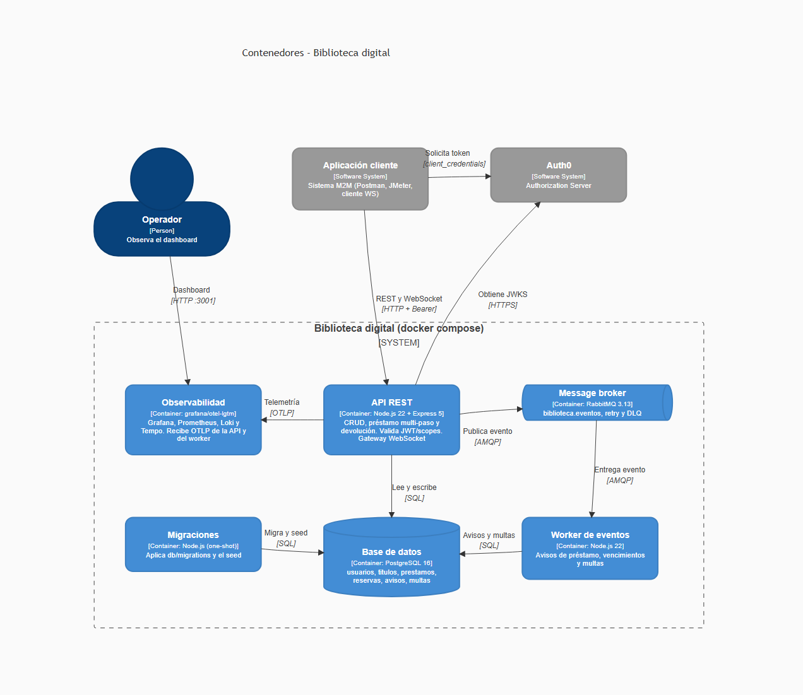

# Biblioteca digital

> TPI IAEW 2026 · Entrega 2: implementación · Dominio 5

[](https://github.com/EnzoG02/TPI-IAEW-2026/actions/workflows/ci.yml)

API REST para prestar e-books con cupo limitado y lista de espera. Incluye OAuth 2.0/JWT con Auth0, un flujo asincrónico
con RabbitMQ, avisos en tiempo real por WebSocket, observabilidad con OpenTelemetry y Grafana, y pruebas con
Postman/Newman y JMeter. Todo se levanta con Docker Compose.

## Índice

1. [Proyecto](#proyecto) · 2. [Problema y alcance](#problema-y-alcance) · 3. [Arquitectura](#arquitectura) ·
4. [Requisitos previos](#requisitos-previos) · 5. [Variables de entorno](#variables-de-entorno) ·
6. [Configuración de Auth0](#configuración-de-auth0) · 7. [Levantar el entorno](#levantar-el-entorno) ·
8. [Datos iniciales](#datos-iniciales) · 9. [Probar con token](#obtener-un-token-y-probar-con-bearer) ·
10. [x-api-key](#probar-el-endpoint-con-x-api-key) · 11. [Endpoints](#endpoints-principales) ·
12. [Flujo asincrónico](#flujo-asincrónico-rabbitmq) · 13. [WebSocket](#integración-websocket-lista-de-espera) ·
14. [Observabilidad](#observabilidad) · 15. [Pruebas](#pruebas) · 16. [Decisiones técnicas](#decisiones-técnicas) ·
17. [Limitaciones](#limitaciones-conocidas-y-mejoras-futuras) · 18. [Evidencias](#evidencias) · 19. [Entrega](#entrega-tag-y-hash)

## Proyecto

- **Dominio:** Biblioteca digital (Dominio 5)
- **Materia / Comisión:** Integración de Aplicaciones en Entorno Web / 5k4
- **Repositorio:** <https://github.com/EnzoG02/TPI-IAEW-2026>
- **Integrantes:**

| Nombre y apellido | Legajo |
| :--- | :--- |
| Ostertag Garcia Bautista | 97621 |
| Cagnolo Ezequiel | 83630 |
| Gardel Enzo Uriel | 98019 |
| Valverde Segura Fabrizio | 96061 |

## Problema y alcance

Una biblioteca presta e-books con licencias limitadas: cada título tiene un **cupo** de préstamos simultáneos. Un
usuario habilitado puede pedir un e-book si hay cupo; si no lo hay, puede quedar en **lista de espera** y es avisado en
tiempo real cuando se libera un ejemplar, que queda guardado para él.

| Requisito de la consigna | Cómo se cubre |
|---|---|
| CRUD de 2 entidades | **Títulos** y **Usuarios** (`/titulos`, `/usuarios`) |
| Transacción multi-paso | **Prestar un e-book** (`POST /prestamos`): usuario existente y habilitado → sin préstamos vencidos → título existente (bloqueado con `FOR UPDATE`) → sin préstamo duplicado → cupo respetando la lista de espera → descuenta cupo y calcula el vencimiento → publica `prestamo.creado`. También la **devolución** (`POST /prestamos/{id}/devolucion`) |
| Errores del dominio | cupo agotado (409), préstamo duplicado (409), usuario bloqueado (403), título inexistente (404); además préstamos vencidos (403), reserva duplicada (409) y borrado con historial (409) |
| OAuth 2.0 + JWT con scopes | Auth0, `client_credentials`, 6 scopes por endpoint; cliente "lector" para mostrar el 403 |
| Productor → broker → consumidor | API → RabbitMQ (`prestamo.creado`) → worker, que registra avisos, vencimientos y multas; con reintentos y DLQ |
| Integración adicional | **WebSocket** de lista de espera (`/ws/lista-espera`) |
| Observabilidad | Logs JSON con correlation ID, dashboard con p95, throughput y error rate, métricas de negocio y trazas |
| Pruebas | Colección Postman (Newman) y prueba de carga con JMeter, con reportes |

## Arquitectura



- Diagramas C4: [Contexto](docs/c4/01-context.md) · [Contenedores](docs/c4/02-container.md) · [Componentes de la API](docs/c4/03-component.md)
- Contrato: [api/openapi.yaml](api/openapi.yaml) (OpenAPI 3.1). Con el stack levantado: Swagger UI en <http://localhost:3000/api-docs>.
- Decisiones: [ADRs](docs/adr/README.md).

| Servicio (compose) | Imagen / tecnología | Puerto en el host | Rol |
|---|---|---|---|
| `api` | Node.js 22 + Express 5 (`services/api`) | 3000 | API REST + WebSocket |
| `worker` | Node.js 22 (`services/worker`) | – | Consumidor de RabbitMQ + job de vencimientos |
| `migrate` | imagen de la API, se ejecuta y termina | – | Migraciones versionadas + seed |
| `db` | PostgreSQL 16 | 5432 | Base de datos |
| `broker` | RabbitMQ 3.13 (management) | 5672 / 15672 | Mensajería (consola en <http://localhost:15672>) |
| `otel-lgtm` | grafana/otel-lgtm 0.35 | 3001 | Grafana + Prometheus + Loki + Tempo |
| `tools` (perfil) | imagen de la API | – | Cliente WebSocket de demo, reset de la base |
| `newman` (perfil `tests`) | dannydainton/htmlextra | – | Corre la colección Postman |
| `jmeter` (perfil `carga`) | alpine/jmeter 5.6.3 | – | Prueba de carga |

Estructura del repositorio:

```
api/openapi.yaml            contrato OpenAPI 3.1
services/api/               API (src/, scripts de migración, seed y cliente WS)
services/worker/            worker de eventos
db/                         migraciones SQL y seed
observabilidad/             provisioning de Grafana (datasources y dashboard)
tests/postman/              colección, environments y script de Newman
tests/carga/                plan de JMeter y script
tools/issuer-local/         emisor JWT local (solo pruebas/CI)
docs/                       C4, ADRs, guía de Auth0, guion de la demo y evidencias
```

## Requisitos previos

- **Docker Desktop** (o Docker Engine) con **Docker Compose v2**. Con unos 4 GB de RAM asignados alcanza (`otel-lgtm` usa ~1 GB).
- **Git**. Los comandos de este README son de bash (en Windows, Git Bash).
- Una cuenta gratuita de **Auth0** (ver más abajo).
- Puertos libres: 3000, 3001, 5432, 5672 y 15672.
- No hace falta instalar Node.js, Newman ni JMeter: todo corre en contenedores.

## Variables de entorno

```bash
cp .env.example .env
```

| Variable | Uso |
|---|---|
| `API_PORT` | Puerto de la API en el host (3000) |
| `POSTGRES_USER`, `POSTGRES_PASSWORD`, `POSTGRES_DB`, `DATABASE_URL` | Base de datos |
| `RABBITMQ_DEFAULT_USER`, `RABBITMQ_DEFAULT_PASS`, `RABBITMQ_URL` | Broker |
| `AUTH0_DOMAIN`, `AUTH0_AUDIENCE` | Lo único que necesita la API para validar tokens |
| `AUTH0_CLIENT_ID`, `AUTH0_CLIENT_SECRET` | Cliente M2M completo (Newman, JMeter, cliente WebSocket) |
| `AUTH0_LECTOR_CLIENT_ID`, `AUTH0_LECTOR_CLIENT_SECRET` | Cliente M2M de solo lectura (prueba del 403) |
| `API_KEY` | Clave del endpoint de comparación `/status/api-key` |
| `MAX_RETRIES`, `RETRY_DELAY_MS`, `SIMULATE_TRANSIENT_FAILURES` | Reintentos del worker (y simulación de fallas para la demo) |
| `VENCIMIENTOS_INTERVAL_MS`, `MULTA_MONTO` | Job de vencimientos |
| `GRAFANA_ADMIN_PASSWORD` | Contraseña de `admin` en Grafana |

`.env` está en `.gitignore`: los secretos nunca se suben. `.env.example` tiene solo valores de ejemplo.

## Configuración de Auth0

Guía paso a paso: **[docs/auth0.md](docs/auth0.md)**. Resumen:

| Elemento | Valor |
|---|---|
| API (audience) | `https://api.biblioteca.local`, firma RS256, token de 3600 s |
| Issuer | `https://TU_TENANT.us.auth0.com/` |
| Scopes | `read:titulos`, `write:titulos`, `read:usuarios`, `write:usuarios`, `read:prestamos`, `write:prestamos` |
| Cliente M2M `biblioteca-cliente` | autorizado con los 6 scopes |
| Cliente M2M `biblioteca-lector` | solo `read:titulos`, `read:usuarios`, `read:prestamos` |

La API valida firma (JWKS), `iss`, `aud`, `exp` y el scope de cada endpoint ([ADR 003](docs/adr/003-seguridad-oauth2-jwt-auth0.md)).

## Levantar el entorno

```bash
cp .env.example .env        # y completar los valores de Auth0
docker compose up -d --build --wait
```

`--wait` espera a que todo esté sano. Orden de arranque: `db` → `migrate` (migraciones + seed, termina con código 0)
→ `api` y `worker`. Verificar:

```bash
docker compose ps                         # api, db, broker, otel-lgtm healthy; migrate "Exited (0)"
curl http://localhost:3000/health         # {"status":"ok","service":"api"}
```

| Herramienta | URL | Credenciales |
|---|---|---|
| API / Swagger UI | <http://localhost:3000/api-docs> | – |
| Grafana | <http://localhost:3001> | `admin` / `GRAFANA_ADMIN_PASSWORD` |
| RabbitMQ | <http://localhost:15672> | `RABBITMQ_DEFAULT_USER` / `RABBITMQ_DEFAULT_PASS` |

Detener: `docker compose down` (conserva datos) · borrar todo: `docker compose down -v`.

## Datos iniciales

Las migraciones (`db/migrations/`) y el seed (`db/seed.sql`) los aplica el servicio `migrate` en cada arranque: cada
migración se aplica una sola vez (tabla `schema_migrations`) y el seed solo si la base está vacía
([ADR 002](docs/adr/002-base-de-datos-postgresql.md)). Para volver a los datos de demo sin bajar nada:

```bash
docker compose run --rm tools node scripts/reset.js
```

El seed reproduce cada caso del préstamo:

| Caso | `POST /prestamos` | Resultado |
|---|---|---|
| Préstamo exitoso | `{"usuarioId": 2, "tituloId": 1}` | 201 |
| Usuario bloqueado (Carla) | `{"usuarioId": 3, "tituloId": 1}` | 403 `USUARIO_BLOQUEADO` |
| Préstamos vencidos (Diego) | `{"usuarioId": 4, "tituloId": 1}` | 403 `PRESTAMOS_VENCIDOS` |
| Título inexistente | `{"usuarioId": 2, "tituloId": 99}` | 404 `TITULO_NO_ENCONTRADO` |
| Préstamo duplicado (Ana ya tiene *El Aleph*) | `{"usuarioId": 1, "tituloId": 3}` | 409 `PRESTAMO_DUPLICADO` |
| Cupo agotado (*El Aleph*) | `{"usuarioId": 2, "tituloId": 3}` | 409 `CUPO_AGOTADO` |
| Unirse a la lista de espera | `{"usuarioId": 2, "tituloId": 3, "unirseListaEspera": true}` | 409 `RESERVA_DUPLICADA` (Bruno ya está en la cola) |

Bruno (usuario 2) espera *El Aleph*: cuando Ana lo devuelve (`POST /prestamos/1/devolucion`) Bruno recibe el aviso
por WebSocket y es el único que puede tomar ese cupo.

Modelo de datos:

```
usuarios(id, nombre, email*, estado)
titulos(id, titulo, autor, isbn*, cupo_total, cupo_disponible)
prestamos(id, usuario_id→usuarios, titulo_id→titulos, fecha_prestamo, fecha_vencimiento, fecha_devolucion, estado)
reservas(id, usuario_id→usuarios, titulo_id→titulos, estado, created_at, notificada_at)
avisos(id, usuario_id→usuarios, prestamo_id→prestamos, reserva_id→reservas, tipo, canal, created_at)
multas(id, prestamo_id*→prestamos, usuario_id→usuarios, monto, estado, created_at)
```

## Obtener un token y probar con Bearer

```bash
source .env   # carga AUTH0_* en la terminal
TOKEN=$(curl -s --request POST "https://$AUTH0_DOMAIN/oauth/token" \
  --header 'content-type: application/json' \
  --data "{\"grant_type\":\"client_credentials\",\"client_id\":\"$AUTH0_CLIENT_ID\",\"client_secret\":\"$AUTH0_CLIENT_SECRET\",\"audience\":\"$AUTH0_AUDIENCE\"}" \
  | sed -E 's/.*"access_token":"([^"]+)".*/\1/')

curl http://localhost:3000/titulos -H "Authorization: Bearer $TOKEN"
```

| Prueba | Resultado |
|---|---|
| Sin header `Authorization` | 401 `NO_AUTENTICADO` |
| Token alterado o vencido | 401 `NO_AUTENTICADO` |
| Token del cliente lector en `POST /titulos` | 403 `SIN_PERMISO` ("Se requiere el scope write:titulos") |
| Token del cliente completo | 2xx |

## Probar el endpoint con x-api-key

Solo como comparación con OAuth 2.0 (no expira ni tiene scopes):

```bash
curl http://localhost:3000/status/api-key -H "x-api-key: $API_KEY"   # 200 {"status":"autenticado con api key"}
curl http://localhost:3000/status/api-key -H "x-api-key: otra"       # 401 NO_AUTENTICADO
```

## Endpoints principales

Contrato completo con ejemplos de request/response: [api/openapi.yaml](api/openapi.yaml) y Swagger UI en `/api-docs`.

| Método y ruta | Scope | Descripción |
|---|---|---|
| `GET /health` | público | Estado de la API y la base (200 / 503) |
| `GET /status/api-key` | `x-api-key` | Endpoint de comparación |
| `GET /titulos?autor=&soloDisponibles=&page=&pageSize=` | `read:titulos` | Lista paginada |
| `POST /titulos` · `GET/PUT/DELETE /titulos/{id}` | `write:titulos` / `read:titulos` | CRUD de títulos |
| `GET /usuarios?estado=` · `POST /usuarios` · `GET/PUT/DELETE /usuarios/{id}` | `read:usuarios` / `write:usuarios` | CRUD de usuarios (bloquear con `PUT`) |
| `POST /prestamos` | `write:prestamos` | **Préstamo multi-paso** (201) o lista de espera (202) |
| `POST /prestamos/{id}/devolucion` | `write:prestamos` | Devolución; avisa al primero de la cola |
| `GET /prestamos?estado=&usuarioId=` · `GET /prestamos/{id}` | `read:prestamos` | Consultas |
| `GET /reservas?tituloId=&estado=` | `read:prestamos` | Lista de espera con posición |
| `GET /avisos?usuarioId=&prestamoId=&tipo=` | `read:prestamos` | Avisos generados (efecto asincrónico) |
| `WS /ws/lista-espera?usuarioId=` | `read:prestamos` | Avisos de cupo en tiempo real |

Ejemplos:

```bash
H="Authorization: Bearer $TOKEN"
curl -X POST http://localhost:3000/titulos -H "$H" -H 'content-type: application/json' \
  -d '{"titulo":"Pedro Páramo","autor":"Juan Rulfo","isbn":"978-8437604183","cupoTotal":2}'     # 201 + Location
curl -X POST http://localhost:3000/prestamos -H "$H" -H 'content-type: application/json' \
  -d '{"usuarioId":2,"tituloId":1,"diasPrestamo":14}'                                        # 201
curl -X POST http://localhost:3000/prestamos/1/devolucion -H "$H"                              # 200
```

Errores: siempre `{ "code", "message", "correlationId" }` con los códigos enumerados en el schema `Error`
([ADR 006](docs/adr/006-estilo-api.md)).

## Flujo asincrónico (RabbitMQ)

1. **Disparo:** un préstamo exitoso (`POST /prestamos` → 201). Después del commit la API publica `prestamo.creado`
   en el exchange `biblioteca.eventos`.
2. **Consumo:** el worker lo toma de la cola `worker.prestamos` y registra el aviso `PRESTAMO_CONFIRMADO`.
3. **Dónde ver el efecto:**
   - API: `GET /avisos?prestamoId={id}` → aparece el aviso `PRESTAMO_CONFIRMADO`.
   - Logs: `docker compose logs worker | grep aviso.registrado` (mismo `correlation_id` que el request).
   - RabbitMQ: <http://localhost:15672> → *Queues* (`worker.prestamos`, `.retry`, `.dlq`).
   - Grafana: panel *Intentos del worker por resultado* y *Avisos por tipo*.

Ejemplo con correlation ID propio:

```bash
curl -X POST http://localhost:3000/prestamos -H "$H" -H 'content-type: application/json' \
  -H 'X-Correlation-Id: demo-async-0001' -d '{"usuarioId":2,"tituloId":1}'
docker compose logs api worker | grep demo-async-0001
```

**Job de vencimientos** (cada `VENCIMIENTOS_INTERVAL_MS`, 60 s): recordatorio para préstamos que vencen en < 24 h;
los vencidos pasan a `VENCIDO` con aviso `VENCIMIENTO` y multa. Al arrancar ya genera la multa del préstamo vencido de
Diego (`GET /avisos?usuarioId=4`).

**Reintentos y DLQ:** con `SIMULATE_TRANSIENT_FAILURES=2 docker compose up -d worker` cada evento falla 2 veces y se
recupera al tercer intento (`evento.reintento` en los logs); con `5` supera `MAX_RETRIES=3` y termina en
`worker.prestamos.dlq`. Volver a la normalidad: `docker compose up -d worker`. Detalle en el [ADR 004](docs/adr/004-broker-rabbitmq.md).

## Integración WebSocket (lista de espera)

1. Suscribir a Bruno (usuario 2) con el cliente de demo (pide su propio token con `client_credentials`):

   ```bash
   docker compose run --rm tools node scripts/ws-client.js 2
   ```

   Muestra `{"type":"suscripcion.ok","usuarioId":2}`.
2. En otra terminal, Ana devuelve *El Aleph*:

   ```bash
   curl -X POST http://localhost:3000/prestamos/1/devolucion -H "$H"
   ```

3. El cliente recibe `{"type":"cupo.disponible","reservaId":1,"usuarioId":2,"tituloId":3,"titulo":"El Aleph",...}`.
   `GET /reservas?tituloId=3` muestra la reserva `NOTIFICADA`; otro usuario recibe 409 `CUPO_AGOTADO` y Bruno 201.

El handshake exige `Authorization: Bearer` con scope `read:prestamos` (sin token: HTTP 401). Ver [ADR 005](docs/adr/005-integracion-websocket.md).

## Observabilidad

- **Logs JSON** en stdout (`docker compose logs -f api worker`) y en Loki, con `timestamp`, `level`, `service.name`,
  `event`, `correlation_id`, `trace_id`.
- **Correlation ID:** enviar `X-Correlation-Id` (o la API genera uno); vuelve en el header de la respuesta, en los
  errores, en el evento de RabbitMQ, en los logs del worker y en el mensaje WebSocket.
- **Dashboard:** <http://localhost:3001> → *Dashboards* → **Biblioteca digital · API, negocio y worker**:
  throughput, latencia p95/p50 por ruta, error rate 4xx/5xx, préstamos activos y vencidos, reservas en espera, avisos
  por tipo, intentos y p95 del worker, y logs filtrables por correlation ID (campo arriba a la izquierda).
- **Trazas:** Grafana → *Explore* → Tempo, buscar por el `trace_id` de cualquier log (también vuelve en el header
  `X-Trace-Id`). Un mismo trace muestra `POST /prestamos` → `prestamo.prestar` → `publicar prestamo.creado` (API) →
  `consumir prestamo.creado` (worker).
- Decisión y métricas: [ADR 007](docs/adr/007-observabilidad-opentelemetry.md).

## Pruebas

**Colección Postman** ([tests/postman](tests/postman)): 53 requests y ~97 aserciones sobre seguridad, CRUD, préstamo
multi-paso, flujo asincrónico (polling a `/avisos`) y lista de espera. Se puede importar en Postman con el environment
`auth0.postman_environment.example.json` (completar `clientId`, `clientSecret`, etc.) o correr con Newman en Docker:

```bash
docker compose --profile tests run --rm newman      # reporte: docs/evidencias/newman/newman-report.html
```

**Prueba de carga con JMeter** ([tests/carga](tests/carga/README.md)): 20 usuarios virtuales, 2 minutos, lecturas y
flujo usuario → préstamo → devolución.

```bash
docker compose --profile carga run --rm jmeter      # reporte: docs/evidencias/carga/reporte/index.html
```

Resultados de la corrida entregada: [docs/evidencias/carga/README.md](docs/evidencias/carga/README.md).

**Tests unitarios** (lógica del consumidor y validación contra el contrato, con `node:test`):

```bash
cd services/worker && npm ci && npm test
cd services/api && npm ci && npm test
```

**CI** ([.github/workflows/ci.yml](.github/workflows/ci.yml), opcional con bono): en cada push corre el lint del
contrato con Redocly, los tests unitarios y una prueba de punta a punta (stack completo con Docker Compose, colección
con Newman y una carga corta con JMeter que falla si el p95 supera 300 ms o los errores el 1 %). Los reportes quedan
como artefactos del workflow.

**Sin Auth0 (CI o pruebas locales):** el override `compose.local-auth.yaml` reemplaza Auth0 por un emisor JWT local
(clientes `local-cliente` / `local-lector`) sin tocar el código de la API:

```bash
docker compose -f docker-compose.yml -f compose.local-auth.yaml up -d --build --wait
docker compose -f docker-compose.yml -f compose.local-auth.yaml --profile tests run --rm newman
```

## Decisiones técnicas

| ADR | Decisión |
|---|---|
| [001](docs/adr/001-rest-vs-grpc.md) | REST/JSON con OpenAPI 3.1 (vs. gRPC y GraphQL) |
| [002](docs/adr/002-base-de-datos-postgresql.md) | PostgreSQL; migraciones versionadas y seed idempotente |
| [003](docs/adr/003-seguridad-oauth2-jwt-auth0.md) | OAuth 2.0 `client_credentials` + JWT con Auth0 y scopes |
| [004](docs/adr/004-broker-rabbitmq.md) | RabbitMQ con reintentos, DLQ e idempotencia |
| [005](docs/adr/005-integracion-websocket.md) | WebSocket para la lista de espera |
| [006](docs/adr/006-estilo-api.md) | Convenciones de la API |
| [007](docs/adr/007-observabilidad-opentelemetry.md) | OpenTelemetry + Grafana LGTM |
| [008](docs/adr/008-estrategia-de-pruebas.md) | Postman/Newman, JMeter y emisor JWT local |

## Limitaciones conocidas y mejoras futuras

- **Sin outbox:** si RabbitMQ cae justo después del commit de un préstamo, el evento se pierde (queda logueado como
  `evento.publicacion_fallida`). Mejora: patrón *transactional outbox*.
- **Suscripciones WebSocket en memoria:** con más de una réplica de la API habría que repartir los avisos (por ejemplo,
  vía RabbitMQ).
- **Reserva notificada sin vencimiento:** si el usuario notificado nunca toma el préstamo, el cupo queda guardado.
  Mejora: que el job cancele las reservas `NOTIFICADA` después de N horas y avise al siguiente.
- **Multas sin endpoint:** se generan y se ven en la base y en los avisos, pero no hay API para consultarlas o pagarlas.
- **Usuarios de la biblioteca ≠ identidades de Auth0:** el token identifica a la aplicación cliente (M2M), no al
  lector; por eso las requests indican el `usuarioId`. Un cliente con usuarios finales usaría Authorization Code + PKCE.
- **`otel-lgtm`** es un backend de observabilidad para desarrollo (todo en un contenedor, sin persistencia larga).
- **Métricas de negocio** consultadas a la base cada 5 s; con mucho volumen convendría contadores en la aplicación.
- Sin despliegue cloud (opcional de la consigna).

## Evidencias

En [docs/evidencias/](docs/evidencias/README.md): reporte de Newman, reporte de JMeter con su resumen, y capturas del
dashboard, Auth0, RabbitMQ y la demo del WebSocket. Guion de la demo: [docs/demo.md](docs/demo.md).

## Entrega: tag y hash

- **Tag/release:** `v1.0.0` (`git checkout v1.0.0`). El tag de la Entrega 1 se renombró a `entrega-1`.
- **Hash del commit entregado:** `COMPLETAR_AL_ETIQUETAR` (el tag `v1.0.0` apunta al commit siguiente, que solo agrega este hash al README).
- **Archivo `.zip`:** generado desde el tag (`git archive --format=zip -o TPI-IAEW-2026-v1.0.0.zip v1.0.0`) y subido a UV/Moodle.
