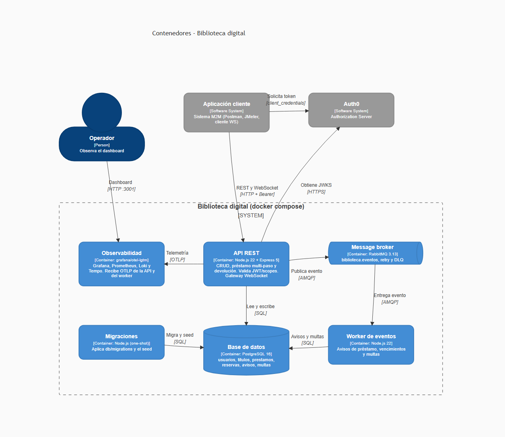
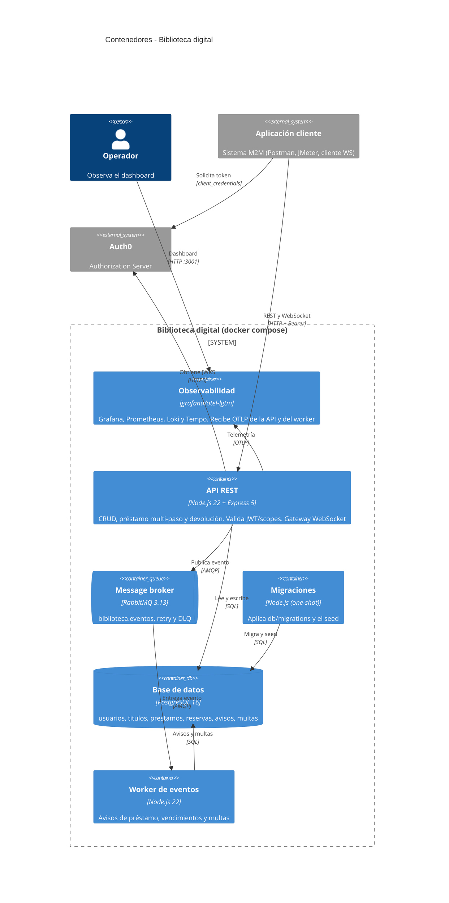

# C4 – Nivel 2: Contenedores

Cada contenedor corresponde a un servicio de `docker-compose.yml`. `migrate` es un contenedor de una sola ejecución:
aplica migraciones y seed y termina antes de que arranquen la API y el worker (ADR 002). La observabilidad usa
`grafana/otel-lgtm` (ADR 007).

Métricas del dashboard: p95/p50, throughput y error rate por ruta; préstamos activos y vencidos, reservas en espera
y avisos por tipo; intentos del worker por resultado. Detalle en el [ADR 007](../adr/007-observabilidad-opentelemetry.md).
